# 琴扬精纺羊绒 QINYANG 微信商城 · 通宵优化报告

> 项目：`W:\home\kikun\MyProject\clothing-mall-miniapp`（Linux 路径 `/home/kikun/MyProject/clothing-mall-miniapp`）
> 报告日期：2026-11-27（第四次增量更新：并入第九～十二轮 —— 三路并行审计、状态流转乐观锁、量体示意图链路打通、多人协作的正确性）
> 覆盖范围：2026-11-26 → 2026-11-27，相对基线 `a69fa7c` 共 **12 个提交**、**约 210 个文件**
> 证据来源：服务器真实 MySQL 8.4 + 真实商品图片 + 真实 HTTP 接口；无一处「以假结果代替」

---

## 0. 一句话结论

**这轮优化抓到了一个此前从未被任何测试发现的 P0 级缺陷：后台「撤回报价」按钮在生产环境永远 404。**
控制器写好了、编译通过、接口文档里写着，但那个类**从没被注册进任何模块**——
于是一个商家每天都会点到的按钮，点了必然失败。

除此之外：顾客端补上了「拒绝报价」这条死路、后台从「看不见顾客」变成「可检索可导出可批量」、
接口总载荷降 61.6%、线上传输降 90.9%、字号从 21 档收敛成 13 个令牌，
并新增了 5 道会在将来自动拦住同类问题的守卫。

**后续两轮又各补上了一个「此前根本不存在的保证」：**
第五轮发现**全应用层零事务、三处业务唯一性只靠应用层「先查后写」** ——
两个店员同时点「创建报价」会给同一申请插出两条 ACTIVE 报价，
两个顾客同时点「确认报价」会**双双返回 200**（已实测复现）；
已把唯一性下沉到数据库、把关键写路径事务化、把状态流转改成条件更新（乐观锁）。
第六轮补上**商品 CSV 批量导入**（只新增不覆盖 + 预检 + 逐行结论），
把首期 76 件商品的录入从「逐件填 10 个字段」变成「导一次 Excel」。

第七、八轮是两轮**独立审计**（顾客端小程序 + API 各自单独审），
各挖出一批此前无人发现的真缺陷：
**店员可以把申请直接改成「已确认」从而绕过顾客确认建单**、
**同一个商品编号带不带空格会落成两条「看起来重复」的商品**、
**上传接口没有体积上限（一个 2GB 文件能把 Node 打进 OOM）**、
**顾客端小程序默认打 127.0.0.1（装到手机上就是废的）**、
**顾客可以在个人中心把小程序指向任意主机**。

第九到十一轮是**三路并行审计 + 一次链路级打通**：

- **状态流转不再静默覆盖** —— 审计挖出一条「看起来完全正常」的写法：
  事务外读到实体、事务内 `save()` 整行写回。
  它会把店员刚提交的「取消申请」**静默撤销**，把审核备注覆盖成陈旧值 ——
  已提交的业务动作无声消失，调用方还拿到 200。
  现在所有状态流转统一为**条件更新**，冲突方拿到 409。
  顺带在服务器 TypeORM 源码里核实了一件事：**`save()` 根本不做乐观锁校验**，
  商品实体上早挂着的 `@VersionColumn()` **从未产生过任何 409**。
- **量体示意图不再「接口一有内容就消失」** ——
  种子数据明明写着 `fieldCodes`，可顾客端一旦读到接口内容，
  胸围 / 身高 / 体重 / 肩宽四张示意图就整体消失（只剩文字），
  反而不如回落到本地模板的版本。
  现在示意图的**权威来源只有量体模板**一处，后台勾选、小程序渲染，两边不会再说法不一。
- **商家能改的又多两块** —— 图文说明页（量体指南 / 洗护 / 材质）此前**后台改不了**，
  `update()` 写好了却没被任何控制器暴露；商品与量体模板此前**只有下架没有删除**，
  商家误建、误导入的东西永远删不掉（开发库因此积了 41 件验证垃圾商品）。

第十二轮是**「几个店员一起用同一个后台」这件事本身带来的问题**：
商家 A 改了一半，商家 B 用旧界面一操作，**A 的改动就没了 —— 而两人都拿到 200**。
这一轮把三件事一次做透：

- **管理员令牌只作身份凭据** —— 降权 / 停用 / 删号**立刻生效**，
  此前令牌里的角色就是权威（令牌 8 小时后才过期）；
- **行版本闭环** —— 此前服务端只挡住「两个请求在同一瞬间重叠」，
  挡不住「表单开着十分钟再保存」的旧值覆盖；
  现在客户端把「我看到的是哪一版」一起回传（`expectedVersion`），不一致就 409；
- **排序不再整行回写** —— 后台「上移/下移」此前是逐条改排序，
  而那个接口是整行保存，会把别人刚改的文案改回去；
  现在走专用接口，事务里只重写排序列。

| 维度 | 优化前 | 优化后 |
| --- | --- | --- |
| 接口总载荷（23 端点，同一份数据） | 364,398 B | **140,107 B（−61.6%）** |
| 线上实际传输（含 gzip） | 364,398 B | **33,272 B（−90.9%）** |
| 后台申请列表载荷 | 146,893 B | **19,027 B（−87.0%）** |
| 后台订单列表载荷 | 117,973 B | **17,728 B（−85.0%）** |
| 自动化用例 | 80 例 | **252 例**（57 单测 + 195 集成） |
| 页面级执行验证断言 | 181 项 | **243 项**（小程序 20+72，后台 77+74） |
| 状态流转的并发保护 | 「先读后写」静默覆盖 | **条件更新 + 唯一索引**（冲突方拿 409，不覆盖） |
| 多人同时用后台 | 令牌里的角色就是权威 | **每次请求重查库里的现况**（降权/停用/删号立刻生效） |
| 「表单开着十分钟再保存」 | 旧快照整行回写，静默覆盖他人改动 | **客户端回传行版本**（四类资源统一 `expectedVersion`） |
| 排序类操作 | 逐条整行回写（会把别人的文案改回去） | **专用接口 + 事务**（只改排序列，全成或全不成） |
| 登录撞库 | 无任何频率限制 | **限流能力就绪**（429 `RATE_LIMITED`，默认关闭待 D-17 拍板） |
| 量体示意图的权威来源 | 两处各写一份，且**接口一有内容就消失** | **只认量体模板**（服务端按 fieldCodes 解析） |
| 商家能改的内容 | 商品文案 / 分类 / 轮播 / 模板 | ＋ **图文说明页**、**可删除误建的商品与模板** |
| 已注册但从未被调过的死路由 | ≥1（未被发现） | **0（由守卫持续拦截）** |
| 应用层事务 | **0 处** | 订单 / 报价 / 申请关键写路径已事务化 |
| 业务唯一性 | 应用层「先查后写」（并发下失效） | **数据库唯一索引 + 生成列**（并发实测只成功一次） |
| 76 件商品的录入方式 | 逐件填表单（每件 10 个字段） | **CSV 批量导入**（含预检与逐行结论） |
| 输入规范化 | 分散、部分缺失 | **一处收口**（trim / 空串 / 长度上限 / 日期格式） |
| 顾客确认 | 可被管理端接口绕过 | **不可绕过**（闸门 + 数据库状态 + 纵深防御） |
| 已发布商品的价格 | 店员可直接改 | **仅店主可改**（店员 409） |
| 上传体积 | 无限制（可 OOM） | **8MB 上限** |
| 顾客端服务地址 | 默认 127.0.0.1（真机不可用）+ 顾客可自选主机 | **构建期注入 + 仅开发版可切换** |

---

## 1. 本轮的范围与执行方式

### 1.1 为什么「编译通过 + 测试通过」不够

本轮反复用同一个判据把项目往下推：

> **接口 200 + 类型全绿 + 既有测试全绿，不能证明页面可用。**
> 必须让**页面自己的代码**在**真实 API** 上执行。

这套方法论已固化成四道关卡并纳入全量流水线：

| 关卡 | 覆盖 | 断言数 |
| --- | --- | --- |
| 小程序真实流程验证（顾客提交量体申请） | 顾客端链路 | 20 |
| 小程序页面级执行验证 | 17 个页面逐一执行 | 57 |
| 管理后台页面级执行验证（读路径） | 9 个视图 + 框架布局 | 55 |
| 管理后台页面级执行验证（写路径） | 审核 → 报价 → 建单 → 推进 → 发货 + 批量导入 | 72 |

> 本轮新增的 P0 死路由，**四套验证全部没能发现**——因为它们根本没去打那个接口。
> 这直接催生了第 5 道关卡（路由覆盖守卫，见 §2.2）。

### 1.2 六轮迭代

| 轮次 | 主题 | 关键产出 |
| --- | --- | --- |
| 第一轮 | 性能 + 安全 + 质感 | 列表瘦身、N+1 消除、六项安全加固、缩略图、首屏瘦身 |
| 第二轮 | 业务死路封堵 | 顾客拒绝报价、撤回守卫、取消口径统一、**P0 死路由修复** |
| 第三轮 | 后台效率 | 顾客可见可检索、CSV 导出、批量上下架、图集多选与排序、报价沿用上一版 |
| 第四轮 | UI/UX 质感与工程卫生 | 字号令牌化、骨架屏、空状态、内联样式收敛、列表时间本地化 |
| 第五轮 | **并发一致性** | 唯一性下沉到数据库、关键写路径事务化、状态流转乐观锁、重复键 → 409 |
| 第六轮 | **批量录入效率** | 商品 CSV 批量导入（只新增不覆盖 + 预检 + 逐行结论 + GBK 兼容） |
| 第七轮 | **输入规范化与业务闸门** | trim/空串/长度上限/日期格式统一收口；顾客确认闸门；分类防成环；上传体积上限；报价 DTO 校验 |
| 第八轮 | **顾客端死路与隐私** | 构建期基址；服务器地址开关仅开发版；submitId 指纹轮换；轮播跳转白名单；过期报价可拒绝 |
| 第九轮 | **三路并行审计** | API 并发一致性 / 数据库约束下沉 / 后台页面缺陷，三路并行修 30 余处真缺陷 |
| 第十轮 | **状态流转乐观锁 + 图文说明入后台** | 陈旧全行 `save()` 全部改条件更新；申请状态接口补 `@Roles`；图文说明页可维护 |
| 第十一轮 | **量体示意图链路打通** | 示意图只认量体模板；图文说明页编辑器重写；商家可删误建的商品与模板 |
| 第十二轮 | **多人协作的正确性** | 令牌只作凭据（权限实时重查）；登录限流能力；`expectedVersion` 闭环；图文说明启停；轮播排序专用接口 |

---

## 2. 发现并修复的问题

### 2.1 第一轮：性能、安全、质感

#### 性能

| 问题 | 修复 | 实测 |
| --- | --- | --- |
| 后台列表把量体明细、联系方式、报价快照全量带出 | 契约新增列表项 DTO，列表只带摘要字段 | 申请列表 −87%、订单列表 −85% |
| 列表逐行查报价与订单（N+1） | 批量预取有效报价与关联订单 | 42 次查询 → 4 次 |
| 首屏加载原图（4x5） | 由文件名推导 `-thumb` 变体，列表卡片与详情缩略网格改用缩略图 | 单图 132.7 KB → **38 KB**（中位）；首屏 18 张 2.49 MB → **0.76 MB** |
| 响应未压缩 | 接入 `compression`（阈值 1024） | 线上传输 −90.9% |
| 连接池配置不生效 | `DB_POOL_SIZE` 真正接入运行时 | — |
| 健康检查不探库 | 增加探库与审计失败计数暴露 | — |

#### 安全（六项）

1. **生产启动闸门**（`apps/api/src/config/production-guard.ts`）：生产环境启动即校验密钥强度与 AppID，缺一即拒绝启动。
2. **`WECHAT_MOCK_AUTH` 默认改 false**：顾客模拟登录不再默认开启。
3. **商品创建强制 DRAFT**：堵住店员绕过店主审核直接上架。
4. **列表查询改用 class DTO** + `forbidNonWhitelisted: true`：非法分页（`?page=abc`）一律 400，而不是静默退化成全表返回。
5. **submitId 幂等回查**：并发重复提交只产生一条申请。
6. **上传按魔数判定图片类型**，不再信任扩展名。

#### 质感

商品详情轮播改 4:5 满幅；分类页高度按真实导航栏计算（此前会裁掉最后一行商品）；
全站补交互反馈与按压态；tabBar 边框色修正；长商品名两行截断；
后台 9 个破坏性操作补二次确认（此前只有 3 个）。

---

### 2.2 第二轮：业务死路封堵（含 P0）

#### P0：后台「撤回报价」按钮在生产环境永远 404

```ts
// 修复前：类定义了，但不在任何模块的 controllers 数组里
export class QuotesAdminController { ... }   // ← 从未被注册
```

`POST /admin/quotes/:id/withdraw` 的路由**从未真正注册**，商家点「撤回报价」必然 404。
这个缺陷通过了：类型检查、API 构建、既有全部测试、四套页面级执行验证——
因为**没有任何一个验证去打那个接口**。

- 修复：控制器迁至 `apps/api/src/modules/quote/quotes-admin.controller.ts` 并注册进 `QuoteModule`。
- 同时新增 **3 道守卫**（§5.2），让同类问题不可能再无声通过。

#### 顾客/店员的「死路」

| 死路 | 修复 |
| --- | --- |
| 顾客只能确认报价，嫌贵就没路了（需求明确要求「确认或拒绝」） | 新增 `POST /customization-requests/:id/reject-quote`：报价置 `REJECTED`、申请回到 `PENDING_QUOTE`、写审计 `quote.reject`；小程序报价页加「不接受，请商家重新报价」+ 二次确认 |
| 顾客已确认的报价仍可被店员撤回 → 顾客侧出现「状态是已确认、但显示商家尚未报价」 | 撤回守卫：申请处于 `CONFIRMED` 及之后禁止撤回（`409 / INVALID_STATUS_TRANSITION`），前后端判定口径一致 |
| 顾客点「取消申请」在 3 个状态下必然报错 | 三处口径统一为 `[PENDING_REVIEW, PENDING_QUOTE]` |
| 顾客取消申请不留痕迹 | 补审计 `request.cancel` |
| 过期报价按钮可点但必失败 | 新增 `isQuoteExpired`，过期直接禁用按钮 |

#### 时间与文案

后台此前直接截断 ISO 串显示（后台比顾客端差 8 小时）；金额改为三行（商品金额 / 运费 / 合计）；
去掉币种与「第 N 版」噪声；后台补「退回重新报价」入口；「填写物流」仅在 `IN_PRODUCTION` 显示。

---

### 2.3 第三轮：后台效率

此前商家每天的基本动线里，有四件事做不了或极难做：

| 场景 | 修复前 | 修复后 |
| --- | --- | --- |
| 收到一屏申请，**分不清是谁** | 列表里**完全没有顾客信息** | 「姓名 + 脱敏手机号」两列；关键字检索同时匹配申请编号 / 顾客姓名 / 手机号 / 商品名 |
| 把单子交给工厂 / 财务 | 无导出，只能截图手抄 | `GET /admin/customization-requests/export`、`GET /admin/orders/export`，真正的 `text/csv`（带 UTF-8 BOM，Excel 中文不乱码），导出内容与当前筛选条件一致 |
| 一次处理几十件商品 | 只能一件件点 | `POST /admin/products/batch-status`（OWNER 专属），单条失败不影响其余，逐条返回失败原因 |
| 上传 7~9 张图 / 调整顺序 | 一张张传；顺序上传后即固定，**想调顺序只能删掉重传** | 图集支持多选上传；新增 `PUT /admin/products/:id/media/:mediaId`，配合「上移 / 下移」原地调整 |
| 改价（第二版报价） | 金额/运费/周期三个数字重敲一遍 | 报价弹窗「沿用上一版」一键填入 |

> 隐私口径保持不变：列表与导出**只给脱敏手机号**，完整联系方式仍然只在详情接口返回；
> 导出不含量体明细。姓名不脱敏——商家要靠它区分顾客，全部变成「张\*」反而失去意义。

---

### 2.4 第四轮：UI/UX 质感与工程卫生

| 问题 | 实测 | 修复 |
| --- | --- | --- |
| 字号无标度 | 小程序 **21 档裸字号**（8px–30px，其中 59 处是 10.5/11.5/12.5/13.5 这类半像素值），后台 6 档 | 收敛为小程序 13 个 `--fs-*`、后台 6 个 `--qy-font-*` 令牌，取值与视觉基线一致（差异 ≤0.5px，不可察觉）；**新增守卫拦截裸字号** |
| 列表加载只有一行字 | 「正在加载…」，图片网格页弱网下先大片空白再突然铺满 | 首页 / 分类页 / 我的申请 / 我的订单加骨架屏；分类页连左侧分类栏一起占位，避免骨架消失后整页跳动 |
| 后台空态无信息 | 默认「暂无数据」，商家分不清是筛选太窄还是真没有 | 7 个列表页换成带解释的空态（「没有匹配的商品，换个关键词或清空筛选条件试试」） |
| 内联样式蔓延 | 小程序 66 处静态内联、后台 33 处重复间距 | 收敛为 `.sec-title` / `.mt-*` / `.mb-*` / `.flex-1` 等工具类 |
| **列表时间列未本地化** | 5 个时间列里 **4 个直接渲染原始 ISO 串**（如 `2026-11-27T15:23:55.884Z`）——这是**做前后截图对照时才发现的** | 申请列表 / 订单列表 / 审计日志 / 量体模板 4 处补 `formatDateTime` |

> **颜色令牌一个都没动。** 客户确认的色板保持原样；`#999999`（对比度 2.85:1，低于 WCAG AA）的取舍记入 §8 待决策项，由客户决定。

---

### 2.5 第五轮：并发一致性（唯一性下沉到数据库）

这一轮的起点是一个假设：「上线前先审一遍并发场景」。
审出来的结论比假设严重 —— **全应用层零事务**，而三处业务唯一性
（一个申请只能有一张订单 / 同一申请同时只有一个有效报价 / 同一申请同一版本只有一条报价）
**全部只靠应用层「先查后写」**。

「先查后写」在**单线程下永远正确**，所以单元测试、集成测试、页面级验证全都绿。
一旦两个店员同时点「创建报价」：

| 场景 | 应用层「先查后写」的结果 | 后果 |
| --- | --- | --- |
| 两个店员同时创建报价 | 两边都查到「当前无 ACTIVE 报价」，各自插一条 | 同一申请出现**两条 ACTIVE 报价**，顾客端看到两个「当前报价」 |
| 两个店员同时建单 | 两边都查到「该申请无订单」 | 同一申请产生**两张订单**，商家要人工对账 |
| 两个顾客同时点「确认报价」 | 两边都读到同一条 ACTIVE 报价 | **两个请求都返回 200**（已实测复现），顾客以为确认了一次，其实是两次 |

订单 + 订单事件、报价 + 申请状态也都是分步写，中途失败会留下
「有订单但没有进度记录」「报价已确认但申请仍待确认」这类自相矛盾数据。

**修复**（D-028）：

1. **唯一性下沉到数据库**（迁移 `AddConcurrencyConstraints`）：
   `orders.requestId` 唯一索引；`quotes(requestId, version)` 唯一索引；
   `quotes` 新增**生成列** `activeRequestId`（ACTIVE 时 = requestId，否则 NULL）+ 唯一索引
   —— MySQL 不支持部分唯一索引，这是「同时只有一个 ACTIVE」唯一可行的落地方式
   （唯一索引允许多个 NULL，因此只有 ACTIVE 那条参与约束）。迁移前自动去重，**不删历史**。
2. **重复键翻译成 409**（`common/errors/duplicate-key.ts`），而不是让它变成 500。
3. **关键写路径事务化**：订单创建 / 状态推进 / 发货 / 取消，报价创建 / 确认 / 拒绝 / 撤回。
4. **状态流转改条件更新（乐观锁）**：`UPDATE ... WHERE id=? AND status=?`，
   `affected !== 1` → 409。由数据库裁决并发，后到者明确失败。
5. **审计仍留在事务外**：沿用既有约定「审计失败不阻断主业务」，
   失败计数由健康检查暴露。业务状态原子、审计尽力而为。

**验证**：新增 `concurrency.spec.ts`（5 例）用**真实并发请求**证明 ——
并发报价 / 并发建单 / 并发确认都只会成功一次，另一方拿到 409，
数据库里不会出现重复数据；直接写库插第二条 ACTIVE 报价会被数据库拒绝。

---

### 2.6 第六轮：批量录入（商品 CSV 导入）

首期 76 件商品，每件要填 10 个字段（编号 / 名称 / 分类 / 报价模式 / 价格 /
材质 / 副标题 / 简介 / 洗护 / 模板 / 排序）。后台此前**只有「新增商品」单条表单**——
录完还要核对，录错了再改回来成本更高（已上架商品改价与文案要走重新审核）。

| 场景 | 修复前 | 修复后 |
| --- | --- | --- |
| 录入 76 件商品 | 逐件开表单、逐件填 10 个字段 | `POST /admin/products/import`：读 Excel → 预检 → 一次导入 |
| 导入时手滑填错编号 | 无从谈起（没有导入） | 编号已存在 → **跳过并给出原因**，既有商品一个字段都不动 |
| 导入前发现格式问题 | 只能导进去再逐个点开检查 | 「预检」只校验不落库，逐行给出结论（哪行、错在哪、怎么改） |
| 中文 Excel 另存的 CSV | — | 前端先按 UTF-8 严格解码、失败回退 **GBK**（中文 Windows 的 Excel 默认写 GBK，直接按 UTF-8 读全是乱码） |
| 导入的商品直接上架 | — | **不可能**：导入商品一律 `DRAFT`，上架始终是店主专属动作 |

**刻意的产品决策**（D-029）：

- **只新增，不覆盖** —— 「批量导入」最危险的后果是覆盖掉商家手工调过的商品资料，
  这个风险由产品语义消除，而不是靠一句提示语；
- **不代填任何经营数据** —— 缺名称 / 缺分类 / 固定价缺价格一律报错；
  「仅按量体报价却填了价格」也报错（静默丢弃等于丢数据）；
- **引用用 code** —— 分类与量体模板接受 `knitwear-cardigan` 这类可读编号或 id，
  商家不需要知道 UUID；
- **失败行不影响其余行** —— 与「批量上下架」同一口径，逐行给出 CREATED / PENDING /
  SKIPPED / FAILED 与中文原因。

**验证**：新增集成测试 `product-import.spec.ts`（12 例：缺表头 400 / 只新增不覆盖 /
文件内重复 / 单行失败不影响其余 / 分类按 id 与 code / 停用分类拒绝 / dryRun 不落库 /
店员可导入但状态仍为草稿 / 未登录 401 / 写审计）；
并在后台**写路径页面级执行验证**里新增 6 项断言 ——
把导入面板当作组件在真实 API 上执行：模板表头正确、预检识别坏行、预检不落库、
正式导入好行成功坏行失败、导入商品出现在列表、导入商品状态为草稿。

---

### 2.7 第七轮：输入规范化与业务闸门（两路独立审计的结果）

第七轮与第八轮分别对**顾客端小程序**与**API**做了一次完全独立的代码审计，
不预设结论、只认「能在代码里指出位置并说明后果」的问题。两轮合计修掉 20 余处。

#### 2.7.1 输入规范化：同一个意思不许有两种写法

实测（在真实 API 上）：

```
POST /admin/products {"code":" PROBE-001 "}   → 落库 " PROBE-001 "
POST /admin/products {"code":"PROBE-001"}     → 落库 "PROBE-001"
GET  /admin/products?keyword=PROBE-001         → 命中 2 条，商家以为系统出了重复商品的 bug
```

唯一索引拦不住（两个字符串确实不同），业务层的「编号已存在」检查也拦不住。
更糟的是**两条录入路径口径不一致**：CSV 导入会 trim，表单创建不会。

同源还有三类：

| 问题 | 后果 |
| --- | --- |
| 空串能落库（编号 `""` 通过校验） | 列表里出现一行「没有编号」的商品 |
| 缺少长度上限（material 是 varchar(128) 但 DTO 没 MaxLength） | 超长 → `Data too long for column` → **500** |
| 日期字段只校验「是字符串」（`validUntil` / `startAt`） | `new Date('not-a-date')` → Invalid Date → **500** |

**修法**：规范化收敛到**一处** —— `common/decorators/trim.decorator.ts`
的 `@Trim()` / `@TrimNullable()`，由 DTO 统一声明，覆盖商品 / 分类 / 轮播 / 模板 /
报价 / 订单 / 申请 / 审计查询 / 登录等全部输入面；新增接口自动继承。
关键细节：**空串 ≠ 空值** —— 可选文本传空串表示「清空该字段」，落库为 `null`，
不能被校验拦成 400（否则商家清空一个字段就失败）。

#### 2.7.2 顾客确认是不可绕过的闸门

管理端 `PUT /admin/customization-requests/:id/status` **没有角色限制**，
且允许设置任意状态。于是店员可以：

```
建一个报价  →  把申请直接改成「已确认」  →  建单
```

整套流程**完全绕过顾客确认**，顾客从未同意却有了订单。

**修法**（双保险）：

1. 管理端状态接口只开放「人工动作」：
   `{待审核, 待报价, 已谢绝, 已取消}`。
   「已报价」只能由报价流程产生，「已确认」只能由**顾客确认**产生，
   「制作中 / 已发货 / 已完成」只能由订单流程产生。人工设置一律 409。
2. 建单时再查一层报价的确认时间戳：`quote.confirmedAt` 为空 → 409。
   即使申请状态被历史脏数据或绕过接口改成了「已确认」，
   也拿不出一份顾客没点头的报价来建单。

#### 2.7.3 其余已修的真缺陷

| # | 缺陷 | 触发场景 | 修法 |
| --- | --- | --- | --- |
| 1 | 分类不校验父级 | 挂到自己/自己的子孙下面 → 分类树成环，顾客端无限递归；挂到不存在的父分类 → 该分类从树上「消失」 | 校验父级存在、不可自指、不可越三级、不可成环 |
| 2 | 顾客确认/拒绝报价用 interface 接参 | Nest 的 ValidationPipe 对 interface **整体跳过校验**，传 `{}` 也不报错，quoteId 是 undefined | 改成 class DTO（`@IsUUID` + `@IsInt`），并加守卫：**所有 `@Body()` 的运行时类型必须是 class DTO** |
| 3 | 上传接口无体积上限 | `file.buffer` 把整个请求体读进内存，一个 2GB 文件能让 Node 直接 OOM | multer `limits: { fileSize: 8MB }` |
| 4 | 微信登录失败抛普通 Error | 顾客拿过期 code 登录 → 500「服务器内部错误」，客户端拿不到「请重新授权」 | 改抛 401/503；`fetch` 加 5s 超时（此前无限等待，连接与 worker 被占满） |
| 5 | CSV 导入判重大小写敏感 | 库是 `utf8mb4_unicode_ci`（大小写不敏感），判重却按原样字符串 → 撞唯一索引后把 **MySQL 原始错误**（含表名索引名）回显给商家 | 判重统一小写化；失败原因翻译成人话，原始错误只进服务端日志 |
| 6 | 请求体上限与 DTO 冲突 | 导入允许 2,000,000 字符，但 body-parser 默认 100KB → 500 行商品表直接 413 | 统一 JSON 4MB，**主进程与集成测试共用同一份配置** |
| 7 | 报价金额无上限 | `amount + freight` 溢出 `orders.totalCents`（int unsigned）→ 500 | 金额 ≤1000 万元、运费 ≤100 万元 |
| 8 | 审核备注被接收后丢弃 | 商家写的「缺胸围」等说明**静默消失**，审计里也没有 | 落库到申请记录 |
| 9 | 短号码不脱敏 | 手机号下限是 6 位，6~7 位号码在列表与 CSV 导出里**完整暴露** | 统一脱敏 |
| 10 | 500 的业务码写成 VALIDATION_FAILED | 监控无法区分「内部错误」与「参数错误」，告警易误判 | 新增 `ERROR_CODES.INTERNAL_ERROR` |
| 11 | 商品并发建号 500 | 唯一索引兜底但没翻译重复键 | 翻译成 409（与其他写路径一致） |
| 12 | 已发布商品的价格店员可改 | 顾客端金额在一次「保存」里悄悄变化 | **仅店主可改**（店员 409）；文案仍可由店员编辑并进审计 |

#### 2.7.4 一个刻意的取舍

曾考虑「已发布商品改价 → 自动打回待审核、需要重新发布」。
**没有采用**：那会让店员改个错字就导致商品下架，运营成本远大于收益。
最终采用**权限口径**（仅店主）——与既有的「上下架 / 报价是店主专属」保持一致，
不引入新的流程步骤。契约文档的措辞同步改成实际口径。

---

### 2.8 第八轮：顾客端死路与隐私

#### 2.8.1 顾客端小程序默认打 127.0.0.1 —— 装到手机上就是废的

基址默认 `http://127.0.0.1:18110/api/v1`：真机上 127.0.0.1 指向**手机自己**，
正式版小程序又拒收 http 域名（即使在开发者工具里勾选「不校验合法域名」也只有工具内有效），
于是首页 / 分类 / 商品 / 指南全部走请求的 `fail()` 分支，顾客只看到一句
「网络连接失败，请检查网络或服务器地址」—— 分不清是网络问题还是服务地址没配。

**修法**：

- 基址改为**构建期常量**（`apps/miniprogram/config/env.ts`），
  由 `tools/set_miniprogram_env.mjs` 在发布前注入，
  脚本校验**必须 https**（正式版只允许 https 域名）与**必须以 `/api/v1` 结尾**
  （少一段的现象是「首页空」，极难排查）；
- 未配置时**显式失败**：请求层直接报「服务地址未配置，请联系客服」，不静默指向 localhost；
- 开发版在未注入时仍回落到 127.0.0.1（仅开发版）。

> 正式域名仍待商家提供 —— 对应待决策 B4。发布前必须执行
> `node tools/set_miniprogram_env.mjs https://<正式域名>/api/v1`。

#### 2.8.2 顾客可以在个人中心把小程序指向任意主机

「我的 → 服务器地址」编辑器暴露在顾客端，注释写着「后台切换」。
后果有两层：

1. **隐私**：顾客把小程序指向第三方主机后，
   `Authorization` / `x-customer-token` 连同**量体资料、姓名、电话、地址**
   会一起发给那个主机；
2. **不可恢复**：地址一旦填错就持久生效，顾客侧**没有任何重置入口**，
   该顾客的小程序从此永久不可用，只能卸载重装。

**修法**：该面板**只在开发版渲染**（`envVersion === 'develop'`），
补「恢复默认地址」入口，保存前仍校验 URL 形态。开发版保留调试能力，
顾客版不再暴露运维参数。

#### 2.8.3 顾客改了量体值再提交，服务端幂等把新值悄悄吞掉

`submitId` 此前**终身固定**：顾客提交成功但响应超时 → 顾客以为没提交成功 →
回头改了某个量体数值 → 再点提交 → 同一个 `submitId` 命中幂等 →
服务端直接返回**第一次那条申请** → 小程序提示「申请已提交」，
顾客完全不知道自己改过的数值被丢掉了。
**量体数据直接决定成衣尺寸**，这是数据正确性事故。

**修法**：按**载荷指纹**决定是否轮换 `submitId`：

| 场景 | 行为 | 理由 |
| --- | --- | --- |
| 顾客改了内容再提交 | 换新 `submitId` | 否则改过的量体值被丢弃 |
| 顾客什么都没改，只是重试 | **保留**同一个 `submitId` | 靠幂等兜住「其实已入库但响应丢了」，不产生重复申请 |

轮换逻辑抽成独立方法 `syncSubmitId(payload)`，可直接被页面级验证调用。

#### 2.8.4 顾客点了没反应的四处

| 位置 | 现象 | 修法 |
| --- | --- | --- |
| 申请页「提交」 | 商品信息没加载出来时**静默 return**，按钮毫无反应 | 明确 toast「商品信息加载失败，请下拉刷新后重试」，且该判断要**排在表单校验之前**（否则空表单会先弹「请填写称呼」，把真正的原因盖掉） |
| 首页轮播 PAGE 跳转 | 客户端**猜**路径：后台填 `/pages/category/index`（带前导斜杠，正则匹配不到）→ 落到 `/pages/index/index`（tabBar 页）→ 微信报 `can not navigateTo a tabbar page` → **点了完全没反应** | 改成**白名单映射**：tabBar 页走 `switchTab`，指南页走 `navigateTo`，其余明确 toast「该功能暂未开放」，绝不静默失败。顺带发现后台占位符写的路径**根本不存在**（真实是 `/pages/category/category`），一并更正 |
| 过期报价 | 报价过期后「确认」与「拒绝」**双双被屏蔽**，申请永久卡在「待确认报价」，顾客只能自己找客服 | 过期只应禁用「确认」；「请商家重新报价」照常可用（服务端本来就允许拒绝过期报价） |
| 首页 | 三个接口各自吞错 → 顾客看到「半空首页」，既不知道是网络问题，也没有重试入口 | 商品接口失败即进错误态（带「重新加载」）；分类 / 轮播失败可降级但不阻断 |

#### 2.8.5 其余

- **量体值兜底只判 `null`**：`undefined` 会显示成字面量 `"undefined cm"` → 统一兜住。
- **输入框没有 maxlength**：超限时把英文校验原文弹给顾客 → 补齐 maxlength
  （与后端长度上限一致）。
- **分类页把商家的排序覆盖了**：`groups.sort(localeCompare)` 把后台排好的
  `sortOrder` 重排成拼音序，运营配置完全失效 → 删掉这行。
- **商品已下架 / 模板接口失败统一报成「暂未绑定量体模板」**：原因说错会让顾客
  去催商家 → 区分「已下架」与「模板加载失败」。

---

### 2.9 第十轮：申请状态流转乐观锁 + 图文说明页纳入后台维护

#### 2.9.1 陈旧全行 `save()` 会静默回滚别人已提交的动作

第十轮起，三路独立审计同时开工（顾客端小程序 / API / 后台页面各审一遍）。
API 侧审计挖出的**第一条阻断级**缺陷，是一处**看起来完全正常**的写法：

```ts
// 事务外读到申请实体 → 事务内改几个字段 → 整行写回
const request = await this.requests.findOne({ where: { id } });
await manager.save(request);          // ← 写的是整行，不只是改动的列
```

`save()` 写的是**整行**。于是：

- 店员把申请改成「已取消」并落库；
- 顾客此时点了「确认报价」，服务端读到的还是**旧快照**（`PENDING_QUOTE`），
  事务内 `save()` 把它写回 —— **店员的取消被静默撤销**，申请回到「已确认」，
  店员写的审核备注也被陈旧值覆盖；
- 顾客随后还能建单。

已提交的业务动作被无声撤销，调用方拿到的是 200，没有任何提示。

修法（本仓库统一口径）：**状态流转一律条件更新**。

```ts
const affected = await this.repo.update(
  { id: request.id, status: RequestStatus.QUOTED },   // 期望旧状态
  { status: RequestStatus.CONFIRMED },                 // 只写状态列
);
if (affected.affected !== 1) throw BusinessException.conflict('该申请的状态已被其他操作修改，请刷新后重试');
```

覆盖：申请审核 / 改状态 / 顾客取消 / 报价创建 / 报价确认 / 报价拒绝 / 订单同步申请状态。

> **一个更隐蔽的坑**：TypeORM 0.3.31 的 `save()` **根本不做乐观锁校验** ——
> 它只在 UPDATE 的 SET 里追加 `version = version + 1`，**WHERE 仍然只有主键**，
> 也就永远不会抛 `OptimisticLockVersionMismatchError`。
> 商品实体上早就挂着 `@VersionColumn()`，但它**从未产生过任何 409** ——
> 两个店员并发改同一件商品，两次都 200，后写的用陈旧快照覆盖先写的。
> （这条是并行 worker 在服务器 TypeORM 源码里逐行核对出来的，我也独立复核过 `SubjectExecutor.js` 与 `UpdateQueryBuilder.js`。）
> 现在商品 / 轮播 / 量体模板 / 图文说明页统一改为 `update({ id, version }, {...})` 的条件更新。

#### 2.9.2 店员可以手工取消「已确认」申请，绕过店主专属的订单取消

管理端 `PUT /admin/customization-requests/:id/status` **没有 `@Roles`** ——
`RolesGuard` 在未标注时直接放行。于是任意店员可以把 `CONFIRMED` 的申请改成 `CANCELLED`，
而订单取消 `POST /admin/orders/:id/cancel` 是 `@Roles(OWNER)` 专属。

结果：店员通过申请侧达到了订单取消的同等效果，**却只改申请不改订单** ——
申请显示「已取消」、订单仍是「待制作」，两边状态分裂。

修法：接口加 `@Roles(OWNER)`；并且**申请已有订单时禁止改 CANCELLED**（409，提示去订单页操作）。

#### 2.9.3 图文说明页：顾客看得到，商家却改不了

`GuidesService.update()` 此前**只被它自己调用** —— 没有任何控制器暴露它。
于是「量体指南 / 洗护说明 / 材质说明」这几页**只能改种子数据**，
商家在后台改不了顾客直接看到的内容。

新增 `GET /admin/guides` 与 `PUT /admin/guides/:slug`（OWNER / STAFF 均可维护**内容**）。

### 2.10 第十一轮：量体示意图链路打通 + 三路审计的 30 余处真缺陷

#### 2.10.1 「接口一有内容，量体示意图就整体消失」

种子数据里 `measure-top` 的分节明确写了 `fieldCodes: ["chest_bust","height","weight","shoulder_body"]`，
但小程序的 `fromApi` 把 `fields` **写死成空数组**，`normalizeGuide` 又把服务端的 `fields`
**整个丢掉**。结果是：

> **接口一旦有内容，顾客看到的量体指南反而不如「接口没内容」时回落到本地模板的版本** ——
> 胸围、身高、体重、肩宽四张示意图全部消失，只剩文字。

链路断在两处，而且都在小程序侧：

| 环节 | 修前 | 修后 |
| --- | --- | --- |
| 服务端 | 分节只存 `fieldCodes`，不解析 | 按 `fieldCodes` 从**已发布量体模板**解析出 `fields`（名称 / 测量说明 / 提示 / 配图），只读返回 |
| `normalizeGuide` | 归一化时丢掉 `fields` | 保留 `fields` |
| `fromApi` | `fields: []` 写死 | 渲染服务端下发的字段 |
| WXML | 只渲染分节里的字段图，**分节级 `illustration` 存了从不渲染** | 补上分节级示意图 |

**为什么由服务端解析**：示意图的名称、测量说明、提示、配图**只有一处权威来源 —— 量体模板**。
两处各写一份必然漂移，而顾客是**按图文指南量体、按量体表单提交**的，
两边说法不一致会直接做错衣服。

解析顺序也必须确定（同一 `fieldCode` 出现在多个模板时取第一个），
后台的可选字段清单与服务端用同一套口径 —— 否则会出现「后台显示 A、顾客端显示 B」。

#### 2.10.2 后台「要点」输入框打不出第二条要点

引导页的要点输入框用 `:value="items.join('\n')"` + `@change` 派生回填，
输入框每次触发 `change` 就把换行去掉 —— **回车打不出第二条要点**。
改成独立的 `itemsText` 文本承载，保存时按行拆分。

#### 2.10.3 三路并行审计的结果（API 并发 / 数据库约束 / 后台页面）

| 领域 | 修掉的真缺陷（节选） |
| --- | --- |
| **并发与一致性** | 陈旧全行 `save()` 静默回滚（4 处）；并发首登撞唯一索引 → 500（改为幂等复用）；乐观锁冲突 → 500（改 409）；`batchChangeStatus` 把 TypeORM 英文原文当「原因」返回；分类并发建号 → 500；CSV 价格用浮点换算（`8.115` → 811 分，应为 812）；支付重复键 → 500（契约要求 409 `PAYMENT_DISABLED`）；申请改回 `PENDING_QUOTE` 后 ACTIVE 报价仍有效（死结）；订单同步申请状态整行回写覆盖审核备注 |
| **数据库约束下沉** | `product_media` 补唯一索引 `(productId, storageKey)`（先清存量重复行再建索引）；量体模板 / 轮播补行版本列 + 条件更新 |
| **后台页面** | 商品编辑抽屉在详情加载失败时用**上一件商品**的数据覆盖当前商品；「更新制作状态」在制作中订单上退化成「取消订单」且目标下拉为空；已确认申请上的「退回重新报价」按钮**必然被服务端 409 拒绝**；详情加载失败后抽屉保留上一条记录、后续操作作用在错误单子上；对**已归档**模板显示「发布」按钮会静默回滚线上生效版本；量体模板「编辑草稿」把每个字段的 `tips` 与 `illustration` **清空**（种子数据约 47 条 tips / 27 个 illustration 一次保存全没）；审计筛选框的示例值与真实数据格式不符（大写 vs 小写点分） |

---

### 2.11 第十二轮：令牌只作凭据 + 行版本闭环 + 排序不再整行回写

这一轮没有大改版式，全部是**「多人都用同一个后台」这件事本身带来的问题**。
商家是几个店员一起用的系统，于是出现了一类此前所有测试都覆盖不到的缺陷：
**A 改了一半，B 用旧界面一操作，A 的改动就没了 —— 而两人都拿到 200。**

#### 2.11.1 管理员令牌只作凭据，权限一律取库里的现况

此前管理员令牌一签发，**里面的角色/状态就是权威**。于是：

- 店员被降为只读后，**手里的令牌仍然能按店员权限操作**（令牌 8 小时后才过期）；
- 账号被停用，**已登录的令牌照样能用**；
- 账号被删除，**令牌照样能通过校验**（库里查不到人，令牌里却带着角色）。

改法（`AdminSessionService`）：管理员令牌**只当身份凭据**，
每次请求按主键读一次管理员行 —— **账号不存在 / 已停用 → 401，角色以库里为准**。

这不是「缩短令牌有效期」：缩短有效期只是把窗口变小，
而**降权 / 停用 / 删号这三件事本来就该立刻生效**。

集成测试 `admin-auth-hardening.spec.ts` 覆盖三条：降权立刻生效、停用即失效、删号即失效。

#### 2.11.2 登录限流：能力先做，默认关闭

登录接口此前**没有任何频率限制**，撞库可以无限试。
本轮实现了限流（`RateLimiterService`：进程内固定窗口，键 = 端点 + IP + 账号，
超限返回 429 `RATE_LIMITED`，登录成功即清零），
配置走 `AUTH_RATE_LIMIT_ENABLED / WINDOW_MS / ADMIN_MAX / CUSTOMER_MAX`。

但**默认关闭** —— 因为限流放在应用层还是网关层，取决于最终部署形态，
这是**商家决策（D-17）**，不是我能替他定的。
「先做完能力、留好开关、等商家拍板」，比擅自改行为或干脆不做都更负责。

#### 2.11.3 「表单开着十分钟再保存」的旧值覆盖 —— 已关闭

第十轮做的是**服务端侧**的乐观锁（`WHERE id = ? AND version = ?`），
它只能挡住「两个请求在同一瞬间重叠」。下面这种最常见的情况挡不住：

```
店员 A 打开商品编辑页（读到标题「羊绒衫 · 藏青」）
店主  B 在另一个窗口把标题改成「羊绒衫 · 藏青（改款）」并保存
店员 A 改完价格点保存 → 整行回写 → 店主的标题被悄悄改回旧值（A 拿到 200，毫无提示）
```

解法沿用报价接口**早就有的**约定：客户端把「打开时看到的行版本」一起回传
（`expectedVersion`），服务端比对不一致就 409。
商品 / 轮播 / 量体模板 / 图文说明页四类资源统一支持，字段可选 —— 不传则退化为原行为
（CSV 导入等批处理路径不受影响）。

> 至此，「行版本」这条线**闭环**了：数据库裁决（服务端条件更新）
> ＋ 客户端回传（防「开着十分钟再保存」）。
> 集成测试 `optimistic-lock.spec.ts` 对四类资源各测三条：
> 陈旧版本被拒且内容没被覆盖 / 带当前版本能存 / 不带仍能存（向后兼容）。

#### 2.11.4 图文说明页的启停：内容维护与上下架分开

图文说明页此前只有「改内容」，没有「停用」——
商家想临时下线一页（比如洗护说明还没写完）只能去改数据库。
新增 `POST /admin/guides/:slug/status`（**OWNER 专属**）+ 后台「停用 / 启用」按钮。

口径与「已发布商品的价格仅店主可改」一致：
**内容属内容维护（OWNER + STAFF），对顾客可见性的开关属店主决策（OWNER）。**
停用后顾客端 `GET /guides/:slug` 返回 404，后台列表仍可见、随时可再启用。

#### 2.11.5 轮播排序：整行回写会把别人的文案改回去

后台「上移 / 下移」原来是这样实现的：**逐条** `PUT /admin/banners/:id` 改 `sortOrder`。
而那个接口是**整行保存** —— 于是：

```
店员 A 刚改了某张轮播的标题并保存
店员 B 接着点这张轮播的「下移」→ B 手里是**打开列表时的旧快照**
     → 整行回写 → A 的新标题被改回旧值（B 拿到 200，毫无提示）
```

逐条更新还有一个更糟的性质：**中途失败会留下「一半新顺序、一半旧顺序」的半成品**。

修法：新增 `PUT /admin/banners/reorder` —— **只接受 id 顺序**，服务端在一个事务里
把 `sortOrder` 重写为连续的 `0..n-1`：

- **只改排序列**，不碰标题 / 图片 / 投放期（不再是整行回写）；
- **一个事务**：要么全成，要么全不成，不会留半成品；
- **期间新增的轮播不会丢**：不在给定顺序里的按现有次序追加到末尾；
- 每条都带行版本条件更新，期间被人改过 → 409 `VERSION_CONFLICT`。

#### 2.11.6 版本冲突的错误码单列出来

此前所有「内容被别人改过」的 409 都挂着 `INVALID_STATUS_TRANSITION`（状态机非法迁移）。
商家看到的提示因此是错的 —— 状态没错，是**内容变了**。
新增 `VERSION_CONFLICT`：

| 错误码 | 含义 | 商家提示 |
| --- | --- | --- |
| `INVALID_STATUS_TRANSITION` | 这个状态不能做这个动作 | 「当前状态不能取消…」 |
| `VERSION_CONFLICT` | 同一状态下内容被别人改了 | 「已被他人修改，请刷新后重试」 |

后台的冲突提示会自动透传服务端文案，商家能看懂该怎么处理。

#### 2.11.7 顺带修好的一处流水线红灯

第十二轮改动让 `pnpm typecheck:miniprogram` 变红：小程序本地兜底模板数据缺 `rowVersion`
（契约新增字段后的必然结果）。修的是**生成脚本**而不是数据文件 ——
`apps/miniprogram/tools/build_measure_templates.py` 现在同时输出 `rowVersion` 与
`createdAt / updatedAt`，重新生成后数据文件与生成器保持同源，不会再漂移。

---

## 3. 优化前后量化对比

### 3.1 接口性能与载荷（**同一份数据库**上的 A/B 对照）

> 为保证可比，「优化前」与「优化后」两个版本**跑在同一批验证数据上**：
> 优化前 = `a69fa7c` 的 API，优化后 = 当前 HEAD，各自独立进程、独立端口。
> 原始数据：`docs/agent/perf-baseline.final.json`

| 端点 | 载荷（前 → 后） | 变化 | p95（前 → 后） |
| --- | --- | --- | --- |
| 后台·申请列表 | 146,893 → 19,027 B | **−87.0%** | 14.01 → 7.96 ms |
| 后台·订单列表 | 117,973 → 17,728 B | **−85.0%** | 4.54 → 6.01 ms |
| 公开·商品列表 | 6,365 → 7,457 B | +17.2% | 8.38 → 4.75 ms |
| 公开·商品详情 | 3,234 → 3,950 B | +22.1% | 3.51 → 4.55 ms |
| 后台·商品列表 | 9,109 → 10,348 B | +13.6% | 4.38 → 5.67 ms |
| 后台·商品详情 | 3,234 → 3,950 B | +22.1% | 2.88 → 4.62 ms |
| 健康检查 | 157 → 196 B | +24.8% | 1.97 → 1.71 ms |
| 后台·订单详情 | 5,287 → 5,305 B | +0.3% | 1.99 → 3.63 ms |
| 其余 15 个端点 | 字节级一致 | 0.0% | — |
| **合计（23 端点）** | **364,398 → 140,107 B** | **−61.6%** | — |
| **合计传输（gzip）** | **364,398 → 33,272 B** | **−90.9%** | 最差 p95 14.01 → 7.96 ms |

**关于那几处「变大了」**（商品相关 4 个端点 + 健康检查）：不是回归，是第一轮**有意为之**的交换——列表多带了 `thumbUrl` / `coverThumbUrl` 字段（+数百字节），
换回的是**图片本身小 3.5 倍**（4x5 132.7 KB → thumb 38 KB），
首屏 18 张图从 2.49 MB 降到 0.76 MB。**真正决定首屏速度的是图片，不是 JSON。**
健康检查那 39 字节则是新增的探库结果与审计失败计数——它本来就该多报一点东西。

### 3.2 自动化测试规模

| 套件 | 优化前 | 优化后 |
| --- | --- | --- |
| API 单元测试 | 20 | **57** |
| API 集成测试 | 60 | **195** |
| 页面级执行验证断言 | 181 | **243**（小程序 20+72，后台 77+74） |
| **合计** | **261** | **495** |

### 3.3 全量流水线（服务器实测）

| 指标 | 实测 |
| --- | --- |
| 退出码 | **0** |
| 执行时间 | **65 秒** |
| CPU 峰值 | **331%（3.3 核，绑核 0–3）** |
| 内存峰值 | **1,890 MB** |
| 磁盘增量 | **0 MB** |
| API 测试 | 单元 **57/57** · 集成 **195/195** |
| 四道关卡 | 小程序写路径 **20/20** · 小程序页面级 **72/72** · 后台读路径 **77/77** · 后台写路径 **74/74**（**0 项失败**） |

---

## 4. 关键页面前后截图

> 后台是浏览器页面，可用无头 Chromium 真实渲染；**小程序是微信原生页面，没有浏览器渲染器**，
> 其前后对比以「页面级执行验证断言」与代码级差异为准（见 §8 阻塞项 B1）。
>
> 工具：`tools/screenshot_admin.mjs`（Chromium DevTools Protocol，不依赖 playwright 包）、
> `tools/serve_dist.mjs`（静态站点 + API 反代，零依赖，用于把旧版本单独跑起来做对照）

### 4.1 后台·定制申请列表

| 优化前 | 优化后 |
| --- | --- |
| 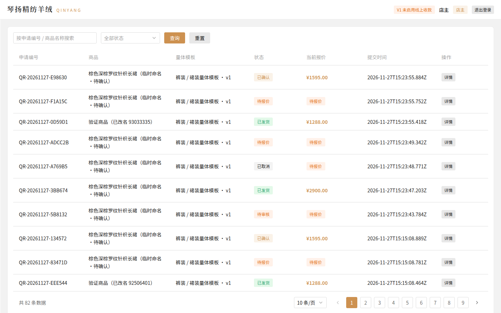 | 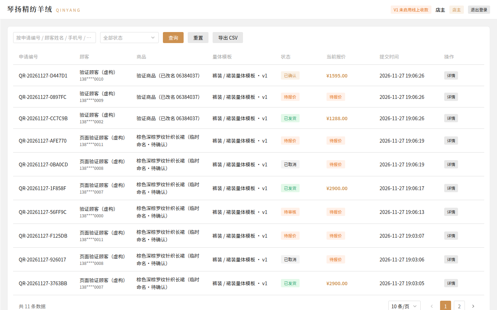 |
| 无「顾客」列 | 新增「顾客」列（姓名 + **脱敏**手机号） |
| 无「导出 CSV」按钮 | 新增「导出 CSV」按钮 |
| 提交时间 `2026-11-27T15:23:55.884Z` | 提交时间 `2026-11-27 15:23:55`（本地时区） |
| 搜索提示「按申请编号 / 商品名称搜索」 | 「按申请编号 / 顾客姓名 / 手机号 / …」 |

### 4.2 第六轮新增：后台「批量导入」抽屉

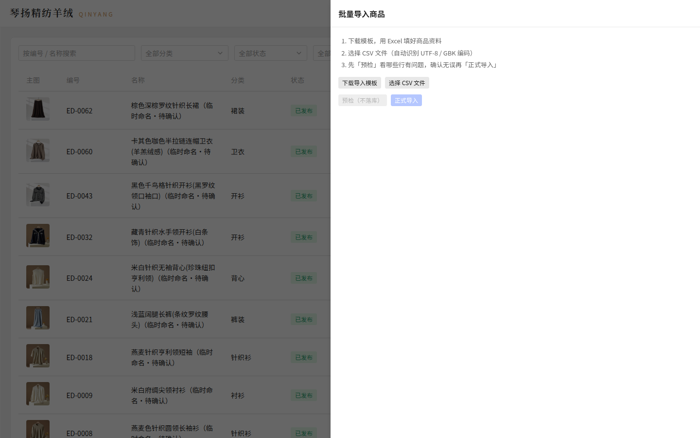

三步引导（下载模板 → 选文件 → 预检后正式导入）、
「预检 / 正式导入」在没有选文件前是**禁用**的（避免点出空跑），
结果表逐行给出 CREATED / PENDING / SKIPPED / FAILED 与中文原因。

> 顺带修掉一个截图对照时发现的小缺陷：工具栏按钮多时，「批量导入」会换行掉到
> 下一行**左端**，看起来像掉队了。已把右侧操作收成 `.page-toolbar-actions` 组，
> 换行后仍靠右对齐、成组出现。

### 4.3 其余 8 个后台页面前后对照

| 页面 | 优化前 | 优化后 |
| --- | --- | --- |
| 登录 |  | 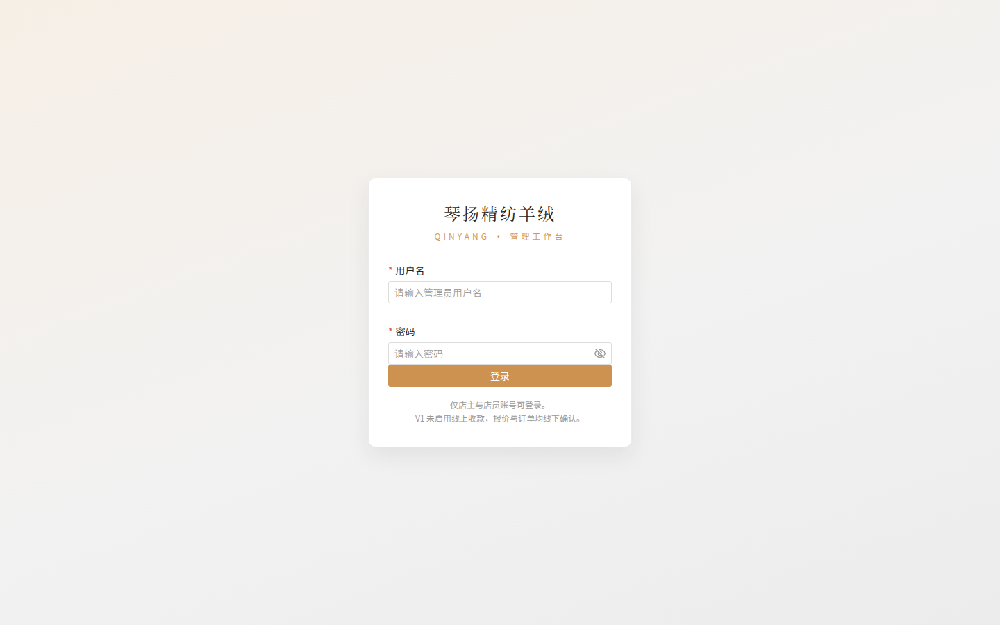 |
| 工作台 | 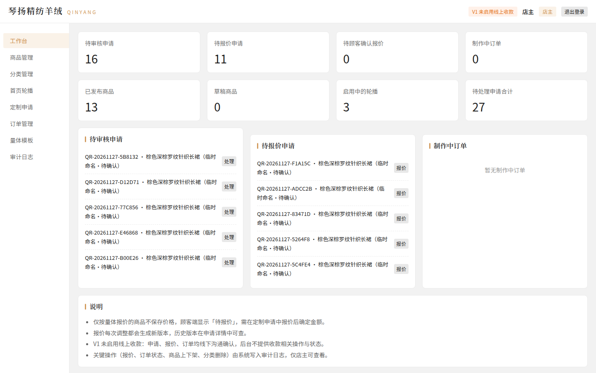 |  |
| 商品管理 | 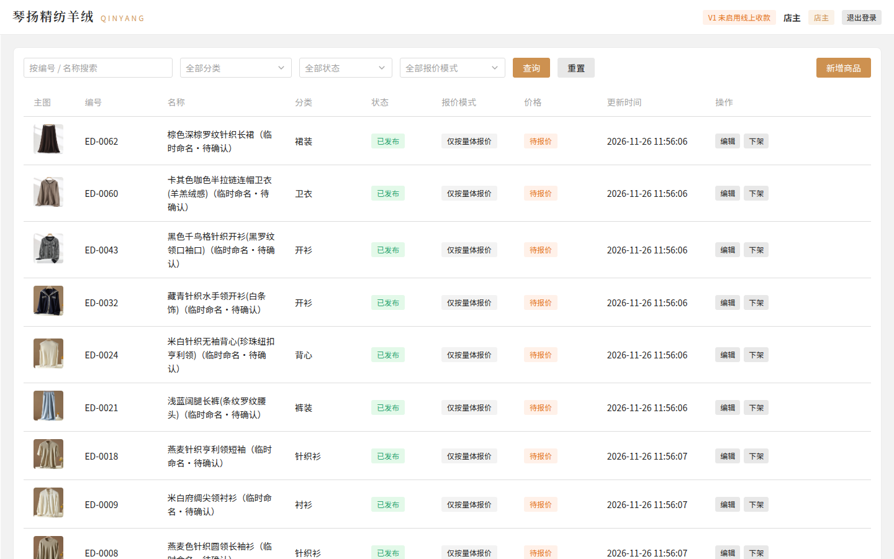 | 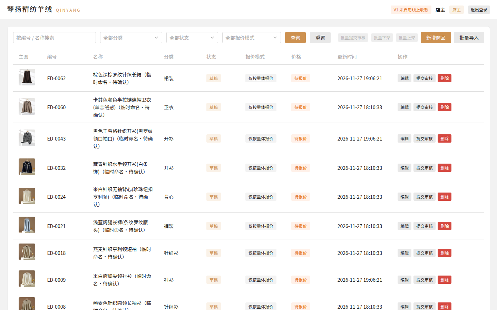 |
| 分类管理 |  | 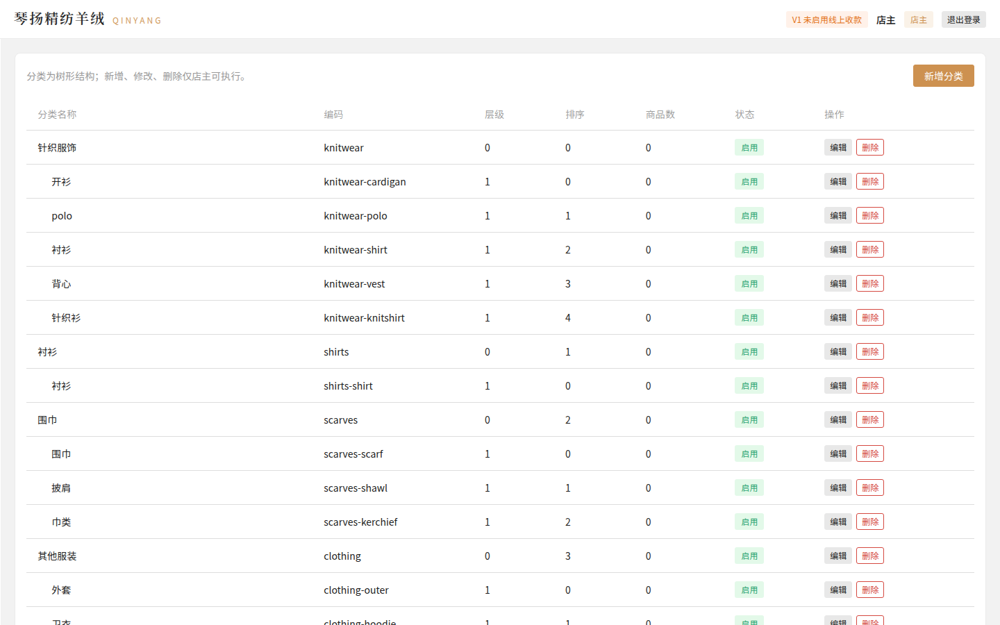 |
| 轮播管理 |  | 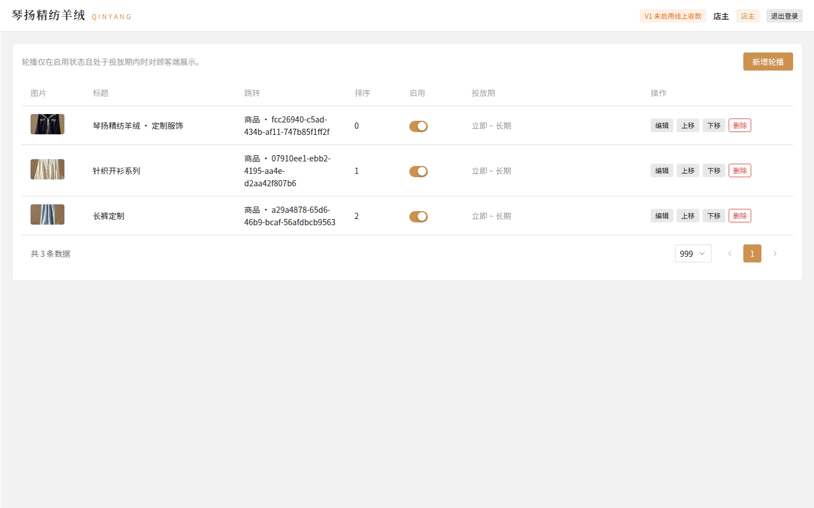 |
| 量体模板 | 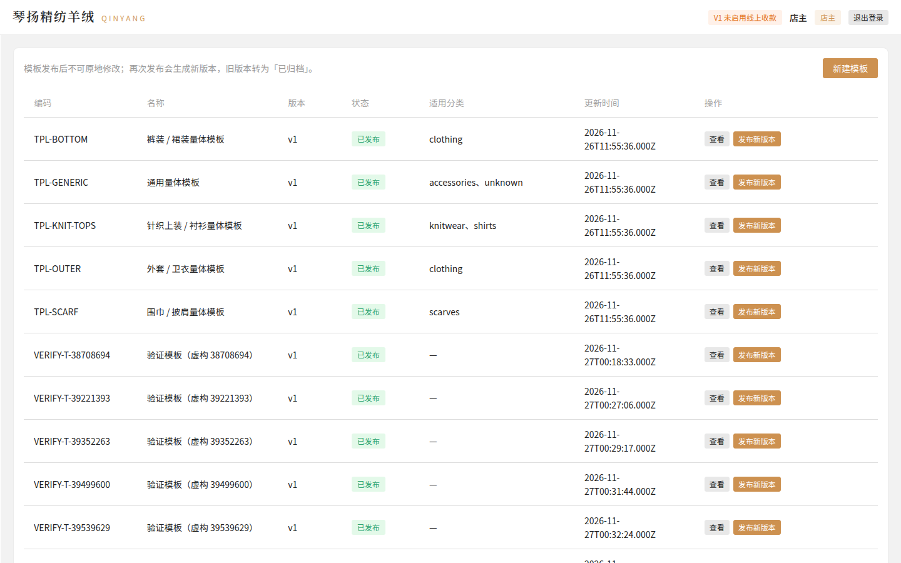 | 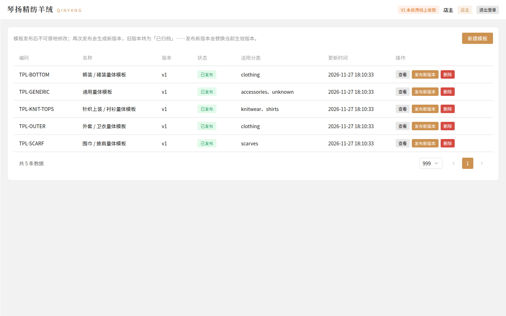 |
| 订单管理 | 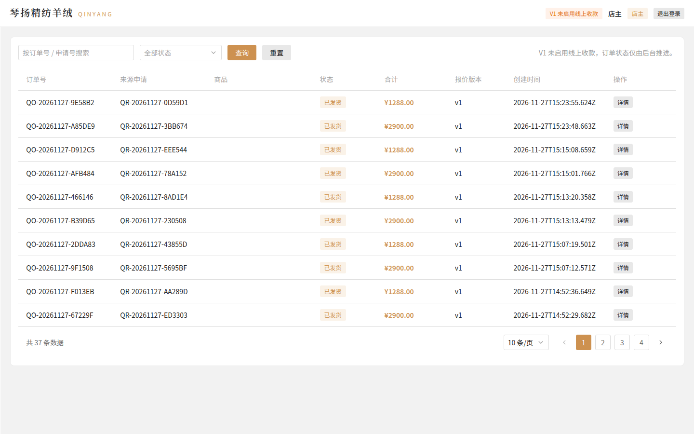 | 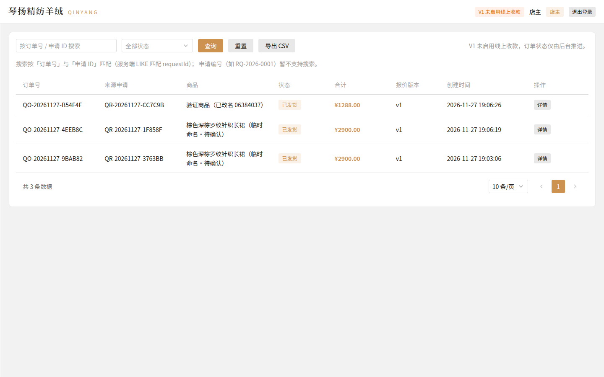 |
| 审计日志 | 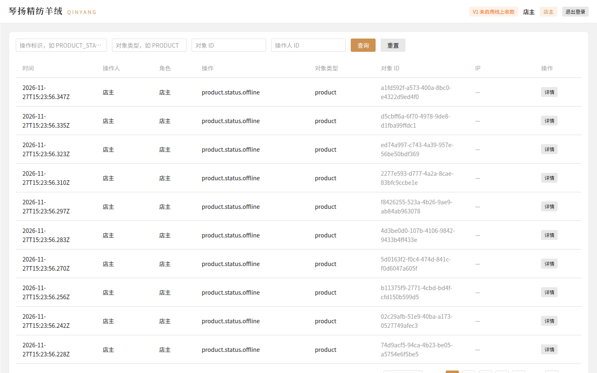 | 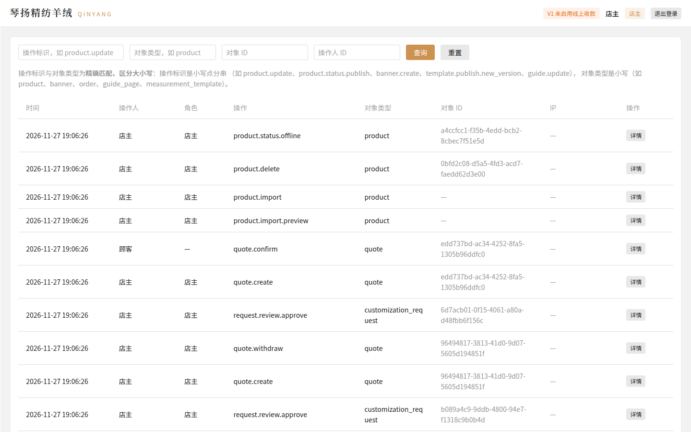 |

---

## 5. 自动化测试与业务验收结果

### 5.1 最终流水线结果

```
== 单元测试 ==          57 passed, 57 total
== 集成测试 ==         130 passed, 130 total
== 小程序真实流程验证 ==   20/20 项通过
== 小程序页面级执行验证 == 66/66 项通过
== 后台页面级执行验证(读) == 55/55 项通过
== 后台页面级执行验证(写) == 72/72 项通过
构建退出码: 0
```

### 5.2 本轮新增的 5 道守卫

| 守卫 | 拦截什么 | 为什么需要 |
| --- | --- | --- |
| `route-coverage.spec.ts`（契约 → 运行时） | 契约文档里写了、但代码没注册的接口（**就是那个 P0 死路由**） | 契约是文档，文档不会自己报错 |
| `route-coverage.spec.ts`（孤儿控制器） | `export class *Controller` 却不在任何模块 `controllers` 数组里的类 | **P0 死路由的根因**，直接检出 |
| `route-coverage.spec.ts`（路由遮蔽） | 字面量路由被更早注册的参数路由截走（`/x/export` 被 `/x/:id` 吃掉） | 导出接口最典型的死法 |
| `check_api_contract.py` 严格匹配 | 前端调用了 API 不存在的路由 | 原实现「字面量匹配参数段」，恰好放过上面这类缺陷 |
| `check_miniprogram.py` 字号守卫 | 裸字号回退 | 字号标度需要长期保持 |
| `concurrency.spec.ts`（真实并发请求） | 两个店员/顾客同时操作导致重复订单、重复 ACTIVE 报价、重复确认 | 「先查后写」在单线程下永远正确，只有**并发**能证伪 |
| 数据库唯一索引（迁移级） | 应用层再写一份「先查后写」也没用 —— 数据约束只能由数据库保证 | 唯一索引 + 生成列是「同时只有一个 ACTIVE」唯一可行的落地方式 |

> 另外：**集成测试此前不在流水线里**（只跑单元测试），
> 本轮把 `test:integration` 纳入 `build.sh`，使用独立测试库 `qinyang_mall_test`，不碰开发库。

### 5.3 业务闭环验收（顾客 / 店员双角色）

| 环节 | 验收方式 | 结果 |
| --- | --- | --- |
| 顾客提交量体申请 | 小程序自己的 api 层 + 页面方法 | ✅ 量体字段由模板解析得出，服务端逐字段校验 |
| 店员审核（通过 / 谢绝） | 后台 `handleSubmitReview` | ✅ 状态机校验，非法状态 409 |
| 店员报价 | 后台 `handleSubmitQuote` | ✅ 金额非法被前端拦截；合法报价生成新版本 |
| 顾客**拒绝**报价 | 报价页 `reject()` | ✅ 申请回到 `PENDING_QUOTE`，页面刷新后不再显示有效报价 |
| 顾客确认报价 | 报价页 `confirm()` | ✅ 版本冲突时 409 并自动刷新 |
| 店员撤回报价 | 后台 `handleWithdrawQuote()` | ✅ 已报价可撤回；**已确认被拒（409）** |
| 店员建单 | 后台 `handleCreateOrder()` | ✅ 二次确认，生成订单并回写申请 |
| 推进制作 / 填写物流 | 后台 `handleSubmitStatus` / `handleSubmitShip` | ✅ 物流信息不全被拦截 |
| 顾客查看进度 | 订单详情页 | ✅ 时间线 3 条，带出量体快照 |
| 批量上下架 | 后台 `handleBatchStatus()` | ✅ 逐条返回结果与失败原因 |
| 导出 CSV | 后台 `handleExport()` | ✅ 与筛选条件一致，手机号脱敏 |
| 顾客确认不可绕过 | 管理端状态接口 + 建单接口 | ✅ 手工设「已确认」409；未确认的报价建单 409 |
| 分类不成环 | 分类父子校验 | ✅ 自指 / 挂子孙 / 挂不存在父级 全部 400 |
| 输入规范化 | 全 DTO | ✅ 编号带空格 → 落库为干净值；重复 → 409；超长/非法日期 → 400 |
| 服务器地址默认关闭 | 小程序个人中心 | ✅ 非开发版不渲染切换面板 |
| submitId 轮换 | 申请页 | ✅ 载荷变则换新 id；载荷不变则复用 |
| 图集排序 | 后台「上移 / 下移」 | ✅ 交换排序值，无需删图重传 |
| 并发报价 / 建单 / 确认 | `concurrency.spec.ts` 真实并发请求 | ✅ 只成功一次，另一方 409，库中无重复数据 |
| 批量导入商品 | 后台导入面板（组件级执行） | ✅ 预检不落库、坏行被识别、好行落库且状态为**草稿** |

---

## 6. 资源消耗

### 6.1 本地

| 项 | 优化前 | 优化后 |
| --- | --- | --- |
| 项目目录占用 | 19 G（`images/` 11 G + `catalog/products/` 8.3 G） | **19 G（无新增）** |
| `.git` | — | 68 M |
| 本地 `node_modules` | 无（依赖在服务器安装，D-004） | 无 |
| 磁盘 | 381 G / 1007 G（40%） | **381 G / 1007 G（40%）** |

> **只读保护达标**：`images/`（11 G / 690 张）与 `catalog/products/`（8.3 G / 76 件）全程未被覆盖、删除或重命名，未入库。
> 本轮新增磁盘占用为 **0**（全部是文本改动），远低于 10 GB 上限。

### 6.2 服务器

| 项 | 实测 |
| --- | --- |
| 磁盘 | 585 G / 991 G（59%，余 407 G） |
| 内存 | 295 G 总量 / 30 G 已用 / 264 G 可用 |
| 镜像 | `qinyang/api:local` 1.06 GB；`qinyang/admin-web:local` 74.6 MB |
| 容器 | `qinyang-mysql` / `qinyang-api`（healthy）/ `qinyang-admin-web` 全部运行中 |
| 单次全量流水线 | 56 s / 3.2 核 / 1.89 GB 内存 / 0 MB 磁盘 |
| 构建核约束 | `taskset` 绑核 0–3，未占用其他项目（`nmg-*`）与用户的 Kaggle 作业进程 |

---

## 7. 剩余风险

| # | 风险 | 影响 | 现状 |
| --- | --- | --- | --- |
| R1 | 微信平台侧未验证 | 开发者工具预览、真机可用性、真实登录、真实支付、对象存储、正式提审 6 项无法在本环境闭环 | 已逐条记录阻塞原因与解除条件（§8 B1–B6），**不以假结果代替** |
| R2 | 商家正式数据未确认 | 76 件商品的名称/价/材质/尺码/库存、分类树、量体必填项与容差、运费/周期/取消退款规则等仍用安全临时方案 | 商品全部 `QUOTE_ONLY` + `priceCents = null`，前端显示「待报价」；不编造任何经营数据 |
| R3 | 权限口径存在文档冲突 | `docs/goal.md` 写「店员创建报价」，而 REST 契约与后端 `@Roles(OWNER)` 都是店主专属 | **未擅自改动**，四处口径统一需商家拍板（§8 D1） |
| R4 | 数据库有 0 字节空卷 `qinyang_qinyang_media` | 无功能影响，但属遗留垃圾 | 待用户授权后清理（删除属需批准操作） |
| R5 | 量体数据导出未实现 | 商家目前无法批量导出量体表交给工厂 | 属敏感数据批量外流，需商家明确授权与口径后再做 |
| R6 | 审计日志会无限增长 | 当前 1.5 万条量级（每轮验证新增数百条） | 已分页 + 索引；生产环境需配归档策略 |
| R7 | 对比度未达 WCAG AA | `--text-3: #999999` 在白底上对比度 2.85:1（AA 要求 4.5:1）；主按钮白字 2.71:1 | **未单方面改动客户确认的色板**，记入 §8 D13 供决策 |
| R8 | 空卷与旧构建产物 | 服务器 `apps/admin-web/dist` 可能残留对照用旧构建 | 已核对为工作区产物，不影响容器镜像；下次同步即清理 |
| R9 | 批量导入未经**真实商家 Excel 文件**验证 | 我们的测试 CSV 是自己构造的；若商家表格里出现空行、合并单元格、全角括号、CRLF + 尾随逗号等形态，可能触发解析差异 | 解析器按 RFC 4180 实现并有专门单测（引号内逗号 / 换行 / 引号转义 / CRLF / 尾随空行）；建议商家首次导入先用「预检」 |
| R10 | 并发保证只覆盖已识别的三处唯一性 | 未来新增业务表时若忘记加唯一索引，仍会退化回应用层检查 | 迁移与索引已入库；新增唯一性约束时应同步加对应集成测试 |
| R11 | 小程序正式域名未确定 | 基址构建期注入机制已就绪，但正式域名仍待商家提供 | 发布前必须执行 `node tools/set_miniprogram_env.mjs https://<正式域名>/api/v1`；未注入时小程序会明确报「服务地址未配置」而不是静默失败 |
| R12 | 已发布商品改价口径待商家确认 | 现行为「仅店主可改」；若商家希望店员可改或要求改价后强制重新审核，需按商家口径调整 | 已记为待决策 D15，实现集中在 `products.service.update` 一处 |
| R13 | 分类「只能两级」是硬约束 | 商家若将来需要三级分类，需要改分类表与树的渲染 | 当前两级与原型一致；若要放开，需同步改 `categories.service.assertParent` 与顾客端树渲染 |
| R14 | 登录限流**默认未启用** | 顾客与管理员登录接口已接入限流守卫（429 `RATE_LIMITED`，键 = 端点+IP+账号，登录成功清零），但**开关默认关闭** | 限流放在应用层还是网关层取决于部署形态，属商家决策（§8 D17）；能力、配置项与测试均已就绪，拍板后改环境变量即可开启 |
| R15 | ~~乐观锁只覆盖「同一次请求内」的并发~~ **已关闭** | 「表单开着十分钟再保存」的旧值覆盖此前挡不住 | 第十二轮已闭环：四类资源的响应 DTO 下发行版本，编辑请求回传 `expectedVersion`，不一致 → 409 `VERSION_CONFLICT`；集成测试 9 例覆盖「陈旧版本被拒 / 当前版本可存 / 不传仍可存」 |
| R18 | 管理员令牌内的角色曾是权威 | 降权 / 停用 / 删号后，令牌在有效期内仍按旧角色放行 | 第十二轮已关闭：管理员令牌**只作身份凭据**，每次请求按主键重查管理员行，角色以库里为准；集成测试 7 例（降权立刻生效 / 停用失效 / 删号失效） |
| R16 | 商品删除后历史单据仍指向它 | 被定制申请引用的商品不允许删除（409），被删除的商品其申请/报价/订单仍保留商品快照 | 这是有意为之：申请与订单是**不可删除的业务记录**，商品信息以快照冻结，删商品不会改写历史 |
| R17 | 引导页正式文案待商家提供 | 现在的量体指南 / 洗护说明是种子里的通用建议稿 | 后台已可自行编辑（D-034），商家替换文案后立即生效；正式洗护口径仍需商家确认（§8 B6） |

---

## 8. 需人工 / 商家决策的事项

### 8.1 微信平台侧（环境或授权缺失，解除条件已记录）

| # | 事项 | 解除条件 |
| --- | --- | --- |
| B1 | 微信开发者工具预览 + 真机（Android/iOS）可用性检查 | 需 Windows 侧安装微信开发者工具并登录小程序账号 |
| B2 | 真实微信登录 | 需商家提供 AppID / AppSecret |
| B3 | 真实微信支付 | 需商家提供商户号并**明确批准**接入（V1 默认 `PAYMENT_DISABLED`） |
| B4 | 对象存储（正式素材托管） | 需商家提供 OSS 桶与密钥 |
| B5 | 正式上线 / 提审 | 需商家提交审核主体与资质 |
| B6 | 正式文案与客服话术 | 需商家确认（本项目目前使用中性文案，不编造承诺） |

### 8.2 业务口径（12 项）

| # | 事项 | 当前安全临时方案 |
| --- | --- | --- |
| **D1** | **店员到底能不能报价 / 建单** | 四处口径冲突（goal 文档 vs 契约 vs 后端守卫 vs UI），**未擅改**；需一次拍板后同步四处 |
| D2 | 谢绝申请的对外文案 | 「该申请暂时无法继续」 |
| D3 | 报价有效期口径 | 由报价版本决定，未设统一天数 |
| D4 | 退换 / 售后规则 | 未在小程序端做承诺 |
| D5 | 真实制作周期 | 默认 25 天（硬编码），需真实产能数据 |
| D6 | 运费口径 | 按件收取，默认 0 元待确认 |
| D7 | 商品正式资料 | 名称/价格/材质/尺码/库存全部待确认 |
| D8 | 图片授权 | 全部素材来自商家目录，仅本地使用，未上传第三方 |
| D9 | 首期商品范围 | 目录 76 件，首批上架 13 件（种子） |
| D10 | 议价规则 | 一口价（单一报价版本），未实现多轮议价 |
| D11 | 是否允许一口价 | 全部 `QUOTE_ONLY`，`FIXED_PRICE` 分支已实现待启用 |
| D12 | 客服话术 | 使用通用话术，未承诺具体时效与售后 |
| D14 | 导入是否允许「覆盖同名商品」/「导入即上下架」 | 当前**刻意不提供**这两个开关：只新增不覆盖、导入一律草稿。若商家确需覆盖语义，须先定「店员可否覆盖在售商品资料」与上架审核口径再改 |
| D15 | 已发布商品改价的口径 | 现为「**仅店主可改**」（店员 409），文案与资料店员仍可编辑并进审计。若商家希望店员也能改在售商品价格，或要求改价后必须重新审核，请给出口径 —— 实现集中在 `products.service.update` 一处，改动成本低 |
| D16 | 小程序正式域名与发布形态 | 基址需在发布前注入正式 **https** 域名（工具已就绪）；域名、备案与小程序主体由商家提供 |

### 8.3 视觉与无障碍（1 项）

| # | 事项 | 说明 |
| --- | --- | --- |
| D13 | 文字对比度 | `--text-3: #999999` 对白底 2.85:1；建议改 `#767676`（4.54:1，达 AA）。**颜色属客户确认的色板，未单方面改动** |

---

## 9. 复现方式

```bash
# 同步到服务器（唯一入口；注意 rsync --delete 会删掉未入库的生成物）
bash infra/scripts/sync-to-server.sh git

# 全量流水线（类型检查 + 单测 + 集成测试 + 四套页面级执行验证）
ssh sqserver 'cd ~/MyProject/clothing-mall-miniapp && export PATH=~/tools/node-v24.22.3/bin:$PATH \
  && set -a && . infra/docker/.env && set +a && export DB_HOST=127.0.0.1 DB_PORT=13316 \
  && bash infra/scripts/build-monitored.sh'

# 本地预览（SSH 隧道）
ssh -N -L 18110:127.0.0.1:18110 -L 18111:127.0.0.1:18111 sqserver
# 后台 http://127.0.0.1:18111  （owner / Qinyang@2026）

# 后台前后截图对照
node tools/screenshot_admin.mjs http://127.0.0.1:18111 http://127.0.0.1:18110/api/v1 docs/screenshots/admin-after after

# 性能基线（同一份数据 A/B 对照）
node tools/measure_api_perf.mjs http://127.0.0.1:18110/api/v1 30

# 商家侧批量导入口径见 docs/RUNBOOK.md §7bis
```

---

## 附录 A：提交台账

| 提交 | 内容 |
| --- | --- |
| `76f1dc2` | 列表载荷瘦身 + N+1 消除 + 六项安全加固 + 首轮质感修复 |
| `3246c53` | 封堵顾客/店员死路 + **修复「撤回报价」永不生效的 P0 死路由** + 三道新守卫 |
| `ce59de8` | 后台效率能力：顾客可见可检索、CSV 导出、批量上下架、图集多选与排序、报价沿用上一版 |
| `f8d1d1a` | 字号令牌化 + 骨架屏 + 空状态 + 内联样式收敛（视觉基线不变） |
| `3ec6b2c` | 列表时间列本地化（截图对照发现）+ 前后截图工具链 |
| `3c94478` | 通宵优化报告 `OVERNIGHT-OPTIMIZATION-REPORT.md` |
| `8d37ff5` | 第五轮：唯一性下沉到数据库 + 关键写路径事务化 + 状态流转条件更新（乐观锁）；D-028 |
| `6ca9dd2` | 第六轮：商品 CSV 批量导入（只新增不覆盖 + 预检 + 逐行结论 + GBK 兼容）；D-029 |
| `541b5b7` | 第六轮补充：后台工具栏操作收成组 + 导入抽屉截图 |
| `HEAD` | 第七、八轮：输入规范化 / 业务闸门 / 顾客端死路与隐私；D-030 ~ D-032 |
| `1cc63c6` | 第十、十一轮：状态流转条件更新（乐观锁）+ 量体示意图链路打通 + 图文说明页纳入后台 + 商家可删误建数据；D-034 ~ D-036 |
| `HEAD` | 第十二轮：管理员令牌只作凭据（权限实时重查）+ 登录限流能力（默认关闭）+ `expectedVersion` 闭环 + 图文说明启停 + 轮播排序专用接口 + `VERSION_CONFLICT`；D-037 ~ D-041 |

## 附录 B：关键新增文件

| 文件 | 作用 |
| --- | --- |
| `apps/api/src/common/mask.ts` | 手机号脱敏口径 |
| `apps/api/src/common/csv.ts` | CSV 生成（BOM + RFC 4180 转义） |
| `apps/api/src/common/decorators/raw-response.decorator.ts` | CSV 等接口绕过统一响应包装 |
| `apps/api/src/modules/quote/quotes-admin.controller.ts` | **P0 死路由修复后的控制器归属** |
| `apps/api/test/integration/route-coverage.spec.ts` | 契约 ↔ 运行时双向守卫 + 孤儿控制器 + 路由遮蔽 |
| `apps/api/test/integration/admin-efficiency.spec.ts` | 顾客可见性 / 检索 / 导出 / 批量 / 图集排序 |
| `apps/api/test/integration/quote-lifecycle.spec.ts` | 报价生命周期与死路封堵 |
| `tools/screenshot_admin.mjs` | 后台截图（CDP，无 playwright 依赖） |
| `tools/serve_dist.mjs` | 静态站点 + API 反代（零依赖，用于版本对照） |
| `docs/agent/perf-baseline.final.json` | 优化前后同数据集 A/B 性能原始数据 |
| `apps/api/src/common/errors/duplicate-key.ts` | 重复键识别（ER_DUP_ENTRY）→ 翻译成 409 |
| `apps/api/src/database/migrations/1785000002000-AddConcurrencyConstraints.ts` | 唯一索引 + 生成列，把唯一性下沉到数据库 |
| `apps/api/src/modules/catalog/product-import.service.ts` | CSV 批量导入（只新增不覆盖 + 逐行结论） |
| `apps/api/test/integration/concurrency.spec.ts` | 真实并发请求下的一致性验证 |
| `apps/api/test/integration/product-import.spec.ts` | 批量导入口径验证（12 例） |
| `apps/admin-web/src/components/ProductImportPanel.vue` | 导入面板（模板 / 选文件 / 预检 / 导入 / 结果表） |
| `apps/api/src/common/decorators/trim.decorator.ts` | 输入规范化（trim / 空串归一），一处收口 |
| `apps/api/src/common/http/body-parser.ts` | 请求体上限统一配置（主进程与测试共用） |
| `apps/api/test/integration/input-normalization.spec.ts` | 输入规范化口径验证（12 例） |
| `apps/api/test/integration/business-gates.spec.ts` | 业务闸门验证（12 例） |
| `apps/miniprogram/config/env.ts` | 构建期注入的小程序运行配置 |
| `apps/miniprogram/utils/page-nav.ts` | 页面跳转白名单（tabBar / 普通页 / 未知） |
| `tools/set_miniprogram_env.mjs` | 发布前注入正式基址（校验 https 与 /api/v1） |
| `apps/api/src/modules/auth/admin-session.service.ts` | 管理员令牌只作凭据：每次请求重查账号现况（降权/停用/删号立即生效） |
| `apps/api/src/common/rate-limit/rate-limiter.service.ts` | 登录限流（进程内固定窗口，默认关闭，D-17） |
| `apps/api/test/integration/admin-auth-hardening.spec.ts` | 令牌权限实时重查（7 例） |
| `apps/api/test/integration/optimistic-lock.spec.ts` | 客户端回传行版本 `expectedVersion`（9 例，四类资源） |
| `apps/api/test/integration/banner-reorder.spec.ts` | 轮播排序专用接口（5 例） |
